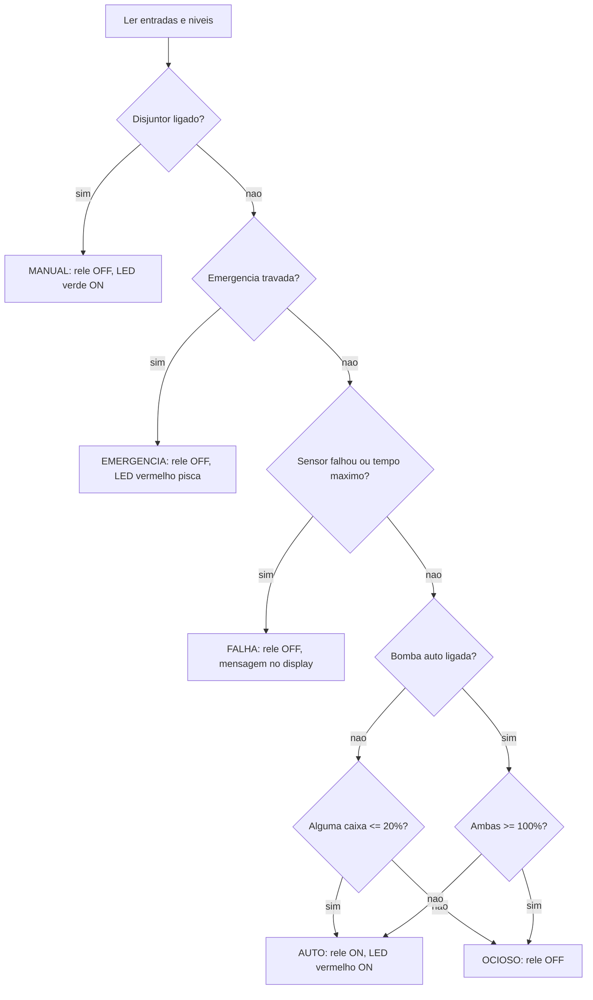
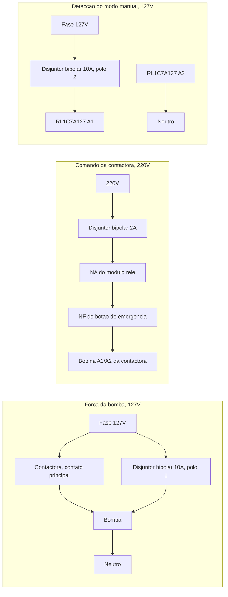

# BombaAutom

Controle automático da bomba d'água de duas caixas (1000 L e 500 L) com ESP32 DevKit V1, sensores ultrassônicos à prova d'água, display LCD, modo manual pelo disjuntor, botão de emergência, watchdog e monitoramento pelo Home Assistant.

A placa de controle é vendida separadamente. Este repositório contém o firmware, a simulação e o monitoramento.

## Sumário

1. [Como o sistema funciona](#1-como-o-sistema-funciona)
2. [Lógica de controle](#2-lógica-de-controle)
3. [Quadro elétrico](#3-quadro-elétrico)
4. [Firmware](#4-firmware)
5. [Home Assistant (MQTT)](#5-home-assistant-mqtt)
6. [Instalação e calibração](#6-instalação-e-calibração)
7. [Simulação no Wokwi](#7-simulação-no-wokwi)
8. [Solução de problemas](#8-solução-de-problemas)
9. [Limitações conhecidas](#9-limitações-conhecidas)
10. [Estrutura do projeto](#10-estrutura-do-projeto)

---

## 1. Como o sistema funciona

A água sai da cisterna e entra sempre na caixa de 1000 L. A caixa de 500 L enche por um bypass a partir dela. Um sensor em cada caixa mede a distância até a água, e a ESP32 converte essa distância em porcentagem.

| Modo | Quando | O que acontece |
|---|---|---|
| **Automático** | Normal | A bomba liga quando **qualquer** caixa chega a 20% ou menos. Ela só desliga quando **as duas** chegam a 100% (98% na configuração, para tolerar a precisão do sensor). O LED vermelho fica aceso enquanto a bomba está ligada. |
| **Manual** | Disjuntor bipolar ligado | A bomba é ligada direto pelo disjuntor. O LED verde acende, o display mostra "MODO MANUAL" e o automático fica bloqueado. |
| **Emergência** | Botão cogumelo travado | A bomba automática para, o LED vermelho pisca e o display mostra "EMERGENCIA!". Ao destravar, o sistema volta ao normal e, se estava enchendo, continua até 100%. |

A prioridade é **Manual > Emergência > Falha > Automático**.

**Proteções:**

- **Falha de sensor:** se um sensor parar de responder por cerca de 2 segundos, a bomba desliga e o display mostra "ERRO SENSOR" e a caixa com problema. Ao voltar, o sensor só é aceito depois de novas leituras válidas.
- **Tempo máximo de bomba:** se a bomba passar de 60 minutos ligada sem encher as caixas (cisterna seca, boia travada, vazamento), ela desliga e o display mostra "TEMPO MAX BOMBA". Para rearmar, trave e destrave a emergência.
- **Religamento:** depois de desligar, a bomba espera pelo menos 30 segundos antes de poder religar.
- **Watchdog:** se o programa travar por 60 segundos, a ESP32 reinicia sozinha, com o relé desligado. O motivo do reinício aparece no Serial e no Home Assistant.
- **Emergência no hardware:** se o cogumelo tiver dois contatos NF, o segundo fica em série com a bobina da contactora. Assim, a emergência corta a bomba mesmo se a ESP32 falhar.
- **Fio rompido:** o botão de emergência é ligado pelo contato NF. Se o fio romper, o sistema entra em emergência.

**Display 16x2.** Na tela normal, cada caixa ocupa metade do display, com o texto centralizado:

```
 CX1000L  CX500L
   75%     40%
```

Em manual, emergência ou falha, o display alterna a cada 3 segundos entre os níveis e uma mensagem de status, por exemplo `MODO MANUAL / Auto bloqueado`, `EMERGENCIA! / Bomba bloqueada` ou `ERRO SENSOR / CX500L`.

---

## 2. Lógica de controle

A cada volta do `loop()`, o firmware lê as entradas e os níveis e escolhe um estado. A prioridade é **Manual, depois Emergência, depois Falha, depois Automático**.



- **Histerese:** a bomba liga com 20% ou menos em qualquer caixa e só desliga quando as duas chegam a 100%. O limite de desligamento está em 98% (`NIVEL_DESLIGA`), por causa da precisão do sensor.
- **Saída da emergência:** ao destravar o cogumelo, o sistema volta ao normal e reavalia os níveis. Se estava enchendo, continua até 100%. Destravar também rearma a falha de tempo máximo.
- **Falha de sensor:** sem eco válido em várias leituras seguidas, o relé desliga. O ciclo de enchimento fica guardado e retoma quando o sensor volta.
- **Tempo máximo:** 60 minutos ligada sem encher as duas caixas (cisterna seca, por exemplo) desliga a bomba até o rearme pela emergência. O tempo é somado durante todo o enchimento: pausas por falha de sensor não zeram a contagem.
- **Intervalo mínimo:** depois de desligar, a bomba espera 30 segundos antes de poder religar.
- **Medição:** cada sensor usa a mediana de 5 leituras com `pulseIn` e timeout. Os dois sensores disparam alternadamente, a cada 70 ms, para um não ouvir o eco do outro. A conversão é `pct = (distVazio - d) / (distVazio - distCheio) * 100`, limitada entre 0 e 100.
- **Sem `delay()`:** LEDs, display e entradas usam `millis()`, para o LED piscar e os botões responderem na hora. O LED vermelho fica aceso enquanto a bomba está ligada no automático.
- **Rede separada do controle:** o Wi-Fi e o MQTT rodam numa tarefa no outro núcleo da ESP32. Uma queda de rede não atrasa a máquina de estados.

---

## 3. Quadro elétrico

A placa de controle é vendida separadamente. Nenhum fio de 127 V ou 220 V passa por ela. O quadro fica assim:



O polo 2 do disjuntor alimenta só a bobina do relé de interface. Ele não tem ligação com a bomba, então o sistema não confunde automático com manual.

**Equipamentos de campo**, além da placa:

| Qtd | Item |
|---|---|
| 2 | Sensor ultrassônico JSN-SR04T |
| 2 | Caixa de passagem IP65, uma ao lado de cada caixa |
| 2 x 20 m | Cabo CAT5e de cobre puro, de preferência blindado |
| 1 | Disjuntor bipolar curva C 10 A |
| 1 | Disjuntor bipolar curva C 2 A |
| 1 | Contactora com bobina 220 V e contato de 10 A ou mais |
| 1 | Relé de interface Atork RL1C7A127 (bobina 127 VCA) |
| 1 | Botão cogumelo com retenção, de preferência com 2 contatos NF |
| 1 | Display LCD 16x2 com módulo I2C |
| 1 | Módulo relé 1 canal 5 V |
| 1 | LED vermelho e 1 LED verde |

---

## 4. Firmware

- **IDE:** Arduino IDE 2, placa `DOIT ESP32 DEVKIT V1` (pacote `esp32` da Espressif; o projeto é compilado com a versão 3.3.12).
- **Bibliotecas:** `LiquidCrystal I2C` (Frank de Brabander) e `PubSubClient` (Nick O'Leary), pelo Gerenciador de Bibliotecas.
- **Ajustes:** ficam em `config.h` (limites de nível, calibração padrão, tempos, polaridade do relé, endereço do LCD e intervalos do MQTT).
- **Monitor Serial (115200):** mostra cada mudança de estado (`ESTADO: OCIOSO -> AUTO`) e, a cada 5 segundos, o nível e a distância de cada caixa.

```powershell
arduino-cli compile --fqbn esp32:esp32:esp32doit-devkit-v1 --output-dir build .
```

---

## 5. Home Assistant (MQTT)

O Home Assistant mostra níveis, estado e alarmes, e permite ajustar a calibração das caixas. Ele **não liga nem desliga a bomba**. Se o Wi-Fi, o broker ou o Home Assistant caírem, o controle continua funcionando normalmente, e a ESP32 reconecta sozinha.

### Configuração

1. No Home Assistant, instale o add-on **Mosquitto broker** e a integração **MQTT**.
2. Crie um usuário para a ESP32 em **Configurações → Pessoas → Usuários**, por exemplo `bombaautom`.
3. Copie `secrets_exemplo.h` para `secrets.h` e preencha a rede Wi-Fi (2,4 GHz), o IP do Home Assistant e o usuário e a senha do MQTT.
4. Compile e grave. O Monitor Serial deve mostrar `WIFI: conectado, IP ...` e `MQTT: conectado`.
5. O dispositivo **BombaAutom** aparece sozinho em **Configurações → Dispositivos e serviços → MQTT**, pelo MQTT Discovery.

Sem o `secrets.h`, o firmware compila com o MQTT desligado (`MQTT: desabilitado` no Serial). É assim que roda no Wokwi. O `secrets.h` está no `.gitignore`.

### Entidades

| Entidade | Tipo | Valor |
|---|---|---|
| Nível CX1000L / Nível CX500L | sensor (%) | Nível de cada caixa; "desconhecido" quando o sensor falha |
| Estado | sensor (lista) | `INICIANDO`, `OCIOSO`, `AUTO`, `MANUAL`, `EMERGENCIA`, `FALHA_SENSOR`, `FALHA_TEMPO` |
| Bomba | binary_sensor | Ligada pelo automático |
| Modo manual | binary_sensor | Disjuntor manual ligado |
| Emergência | binary_sensor (segurança) | Cogumelo travado |
| Falha | binary_sensor (problema) | Erro de sensor ou tempo máximo da bomba |
| Distância sensor CX1000L / CX500L | sensor (cm), diagnóstico | Leitura bruta, usada na calibração |
| Sinal Wi-Fi | sensor (dBm), diagnóstico | |
| Tempo ligado | sensor (s), diagnóstico | Tempo desde o último reinício |
| Motivo do último reinício | sensor, diagnóstico | `ENERGIA`, `WATCHDOG`, `QUEDA_TENSAO`, `ERRO_FIRMWARE`, `SOFTWARE`, `BOTAO_EN` ou `OUTRO` |
| CX1000L / CX500L distância cheia | número (cm), configuração | Distância do sensor até a água em 100% |
| CX1000L / CX500L distância vazia | número (cm), configuração | Distância do sensor até a água em 0% |
| Restaurar calibração padrão | botão, configuração | Volta aos valores de `config.h` |

As mensagens são enviadas assim:

- **Mudanças de estado e alarmes:** publicadas na hora.
- **Níveis:** no máximo a cada 5 segundos.
- **Tudo:** reenviado pelo menos a cada 60 segundos.

Se a ESP32 perder a conexão, o broker marca o dispositivo como indisponível.

| Tópico | Conteúdo |
|---|---|
| `bombaautom/estado` | JSON com todos os valores (retido) |
| `bombaautom/status` | `online` ou `offline` |
| `bombaautom/calibracao` | JSON com a calibração em uso (retido) |
| `bombaautom/calibracao/<campo>/set` | Comandos: `cheio_1000`, `vazio_1000`, `cheio_500`, `vazio_500` ou `padrao` |
| `homeassistant/.../config` | Configurações do Discovery |

**Automação sugerida:** avisar no celular quando **Falha** ou **Emergência** ligar, ou quando o **Motivo do último reinício** for `WATCHDOG`.

---

## 6. Instalação e calibração

A placa de controle é vendida separadamente e já vem preparada para os sensores, o display, o relé, os LEDs e as entradas de emergência e manual.

### Sensores

- Prenda o transdutor na tampa da caixa, com a face para baixo, a pelo menos **25 cm acima do nível de 100%**. O JSN-SR04T não mede abaixo de 20 a 25 cm.
- Não emende o cabo original do transdutor. O cabo longo é o CAT5e, entre a placa do sensor e o quadro.
- Passe o CAT5e em eletroduto separado da fiação de força.

### Calibração

A calibração diz ao firmware qual distância corresponde à caixa **cheia** (100%) e à caixa **vazia** (0%).

**Pelo Home Assistant:** a ESP32 aplica o valor na hora e grava na memória flash, sem gravar o firmware de novo.

1. Com a caixa cheia, copie o valor de **Distância sensor CX1000L** para **CX1000L distância cheia**.
2. Faça o mesmo com a caixa vazia para **distância vazia**. Se não der para esvaziar, meça a profundidade útil com uma trena e some à distância de cheia.
3. Repita para a CX500L.

A distância vazia precisa ser pelo menos 10 cm maior que a cheia, e os valores precisam ficar entre 2 e 450 cm. Um valor fora disso é recusado.

A calibração nova vale na hora também para o automático. Se o novo cálculo deixar uma caixa em 20% ou menos, a bomba liga.

**Sem Home Assistant:** coloque os valores em `CAL_1000` e `CAL_500`, em `config.h`, e grave o firmware. Uma calibração feita antes pelo Home Assistant continua valendo até você usar "Restaurar calibração padrão".

O sketch `teste_sensores/teste_sensores.ino` mostra a distância bruta e a variação das últimas leituras. Com o cabo instalado, a variação deve ficar em até 1 a 2 cm.

---

## 7. Simulação no Wokwi

1. Compile com o comando da seção 4. A extensão usa `build/BombaAutom.ino.merged.bin` e `build/BombaAutom.ino.elf`.
2. Na primeira vez, ative a licença gratuita: `F1` → **Wokwi: Request a New License**.
3. Abra `diagram.json` e rode `F1` → **Wokwi: Start Simulator**.

O botão de reiniciar do simulador não relê o `diagram.json`. Depois de alterar o diagrama, feche a aba do simulador e inicie de novo.

Na simulação, dois HC-SR04 fazem o papel dos JSN-SR04T. O LED azul "BOMBA" só existe no simulador e representa a bomba na saída do relé.

| Caixa | 100% (cheia) | 20% (liga a bomba) | 0% |
|---|---|---|---|
| CX1000L (`sensor1000`) | 25 cm | 89 cm | 105 cm |
| CX500L (`sensor500`) | 25 cm | 73 cm | 85 cm |

- **EMERGENCIA:** esquerda = normal, direita = acionada.
- **DISJUNTOR MANUAL:** esquerda = desligado, direita = ligado.

### Roteiro de teste

| # | Ação | Resultado esperado |
|---|---|---|
| 1 | Iniciar a simulação | "Iniciando..." e, depois, cerca de `CX1000L 56%` / `CX500L 58%`. LED azul e LED vermelho apagados. |
| 2 | `sensor1000` em 95 cm | CX1000L cai para cerca de 13%. A bomba liga, o LED vermelho acende e o Serial mostra `ESTADO: OCIOSO -> AUTO`. |
| 3 | `sensor1000` em 25 cm | CX1000L vai a 100%, mas a bomba continua ligada, porque a CX500L ainda está em 58%. |
| 4 | `sensor500` em 25 cm | As duas em 100%. A bomba desliga e o LED vermelho apaga. |
| 5 | `sensor500` em 80 cm logo depois | A bomba só religa 30 s depois do desligamento. |
| 6 | Com a bomba ligada, EMERGENCIA para a direita | A bomba desliga, o LED vermelho pisca e o display alterna entre "EMERGENCIA! / Bomba bloqueada" e os níveis. |
| 7 | EMERGENCIA de volta para a esquerda | O sistema volta ao normal e a bomba retoma o enchimento até 100%. |
| 8 | DISJUNTOR MANUAL para a direita | O LED verde acende, a bomba automática desliga e o display alterna "MODO MANUAL / Auto bloqueado". |
| 9 | DISJUNTOR de volta e um sensor em 400 cm | Em cerca de 2 s, a bomba desliga e o display mostra "ERRO SENSOR" e a caixa com problema. |

---

## 8. Solução de problemas

| Sintoma | Causa provável | O que fazer |
|---|---|---|
| Display aceso sem texto | Contraste ou endereço I2C | Ajuste o trimpot do módulo I2C; teste `LCD_ENDERECO = 0x3F` |
| "ERRO SENSOR" constante | Cabo, alimentação ou sensor fora do modo 1 | Rode o `teste_sensores` e confira a alimentação do sensor |
| Nível oscilando | Ruído no cabo ou eco em parede/boia | Afaste o cabo da fiação de força; reposicione o transdutor longe das paredes |
| Bomba invertida | Polaridade do relé no firmware | Confira `RELE_ATIVO_EM_LOW` em `config.h` |
| "TEMPO MAX BOMBA" | Bomba ligada mais de 60 min sem encher | Verifique cisterna, boia e vazamentos; trave e destrave a emergência para rearmar |
| `MQTT: falha ao conectar (rc=5)` | Usuário ou senha do MQTT | Confira `secrets.h` e o usuário no Home Assistant |
| `MQTT: falha ao conectar (rc=-2)` | Broker inacessível | Confira o IP do broker e se a porta 1883 está aberta |
| Sem Wi-Fi | Rede de 5 GHz ou sinal fraco | A ESP32 só conecta em 2,4 GHz |
| Motivo do reinício `WATCHDOG` | Firmware travou | O sistema volta sozinho; anote o que acontecia e verifique o Serial |

---

## 9. Limitações conhecidas

- **Reinício durante o enchimento:** se a ESP32 reiniciar com a bomba ligada, ela não lembra que estava enchendo. A bomba só volta quando alguma caixa chegar a 20%.
- **Tempo máximo após a emergência:** destravar a emergência rearma o limite de 60 minutos.
- **Entidade "Bomba" no Home Assistant:** indica só a bomba ligada pelo automático. Com o disjuntor manual, a bomba roda, mas a entidade fica desligada. Quem indica a situação é "Modo manual".
- **MQTT sem criptografia:** a conexão com o broker não usa TLS. Use o broker só na rede local e com usuário e senha. O único comando aceito é a calibração.

---

## 10. Estrutura do projeto

| Caminho | Conteúdo |
|---|---|
| `BombaAutom.ino` | `setup()`, `loop()`, máquina de estados, relé, LEDs e watchdog |
| `config.h` | Limites, calibração padrão, tempos e ajustes do MQTT |
| `sensores.h` | Leitura dos sensores e entradas com debounce |
| `display.h` | Telas do LCD 16x2 |
| `calibracao.h` | Calibração gravada na flash e ajustável pelo Home Assistant |
| `mqtt_ha.h` | Wi-Fi, MQTT e Discovery do Home Assistant |
| `secrets_exemplo.h` | Modelo das credenciais (copiar para `secrets.h`) |
| `teste_sensores/` | Sketch para conferir os sensores |
| `diagram.json`, `wokwi.toml`, `wokwi/` | Simulação no Wokwi |
